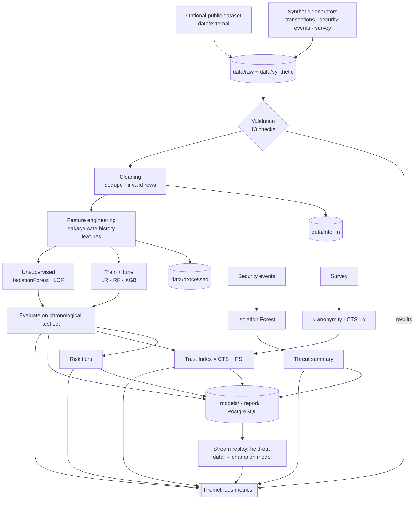

# System architecture

## 1. Container architecture

```mermaid
flowchart LR
  subgraph net[fintech-net (Docker bridge)]
    W[worker<br/>pipeline + /metrics :8000]
    PG[(PostgreSQL :5432)]
    J[JupyterLab :8888]
    P[Prometheus :9090]
    L[Loki :3100]
    PT[Promtail]
    C[cAdvisor :8080]
    G[Grafana :3000]
  end
  W -- results, metadata --> PG
  W -- JSON logs → app_logs volume --> PT --> L
  P -- scrape 5s --> W
  P -- scrape --> C
  P -- scrape --> L
  P -- scrape --> G
  G -- PromQL --> P
  G -- LogQL --> L
  G -- SQL --> PG
  J -- reads data/ models/ ; writes report/ --> W
  J --> PG
  H((Host browser)) -->|localhost only| G & J & P
```

| Service | Image | Role | Persistence |
|---|---|---|---|
| postgres | postgres:16-alpine | structured results, run metadata | `pgdata` volume; schema applied at first start |
| worker | built from `Dockerfile.worker` | runs the pipeline, exports metrics, replays held-out data through the champion model | bind mounts `data/`, `models/`, `report/`, `survey/` |
| jupyter | built from `Dockerfile.jupyter` | interactive research; starts after worker is healthy | project bind-mounted |
| prometheus | prom/prometheus | time-series store, alert rules | `prometheus_data` |
| loki + promtail | grafana/loki, promtail | log storage / shipping | `loki_data`, `promtail_positions`, shared `app_logs` |
| cadvisor | cAdvisor | container CPU/mem/net/disk metrics | - |
| grafana | grafana/grafana | dashboards, alerts (provisioned from files) | `grafana_data` |

Start-up order is enforced with health checks: `postgres → worker (healthy only when fintech_pipeline_ready = 1) → jupyter`;
`prometheus, loki, postgres → grafana`; `loki → promtail`.

## 2. Data flow



## 3. Observability design
* **Metrics** (`src/metrics/exporter.py`): gauges describe the last pipeline run (stage timing, validation, dataset analytics,
  model metrics, trust); counters/histograms describe the live replay (outcomes, risk tiers, inference latency). Names:
  `fintech_pipeline_*`, `fintech_data_*`, `fintech_txn_*`, `fintech_security_*`, `fintech_model_*`, `fintech_trust_*`, `fintech_stream_*`.
* **Logs**: JSON lines (`config/logging.yaml`) → Promtail → Loki. `level` and `logger` are Loki labels.
* **Database**: results tables + views `v_latest_*` feed SQL panels; history of runs is retained.
* **Provisioning**: data sources, dashboards and alert rules are loaded from files at Grafana start; edit
  `infrastructure/scripts/build_dashboards.py`, run `make dashboards`.

## 4. Security of the platform itself
Ports bound to loopback; credentials via environment (`.env` ignored by git); survey IDs salted-hashed; synthetic data only;
Grafana sign-up disabled; no production endpoints exist to attack. Alertmanager is intentionally omitted (lab scope).
